# Kịch Bản Thuyết Trình & Live Demo Đạt Điểm Tối Đa (Presentation & Demo Script)

> **Thời lượng khuyến nghị**: 10 - 15 phút  
> **Mục tiêu**: Chứng minh hệ thống thực tế hoạt động mượt mà, phân chia công việc công bằng và làm chủ toàn bộ kỹ thuật.

---

## ⏱️ Khung Kịch Bản 10 Phút

```mermaid
gantt
    title KỊCH BẢN 10 PHÚT THUYẾT TRÌNH BẢO VỆ ĐỒ ÁN
    dateFormat  X
    axisFormat %s
    section Phút 0 - 2 (Thành viên A)
    Giới thiệu đề tài, Mô hình kiến trúc & Hạ tầng :0, 2
    section Phút 2 - 5 (Thành viên B)
    Demo Apache VirtualHost, PHP & Web App CRUD     :2, 5
    section Phút 5 - 8 (Thành viên C)
    Demo MySQL, SSL, UFW, Fail2ban & Cron Backup    :5, 8
    section Phút 8 - 10 (Cả nhóm)
    Test Chịu tải ab, Phục hồi dữ liệu & Vấn đáp    :8, 10
```



---

### PHẦN 1: Mở Đầu & Giới Thiệu Hạ Tầng (Phút 00:00 - 02:00)
**Người trình bày: Thành viên A (Nhóm trưởng)**
* **Lời thoại gợi ý**:
  > *"Kính chào thầy/cô và các bạn. Nhóm em gồm 3 thành viên xin phép báo cáo đề tài 'Triển khai và Cấu hình Máy chủ Web LAMP Stack trên nền tảng Ubuntu Server'. Hệ thống của nhóm được thiết kế theo tiêu chuẩn tách lớp: Tầng hạ tầng mạng, Tầng máy chủ Web Apache & PHP, Tầng cơ sở dữ liệu MySQL và Tầng an toàn bảo mật với Tường lửa UFW và Fail2ban."*
* **Thao tác Terminal**:
  - Mở Terminal từ xa qua SSH:
    ```bash
    ssh leader@lamp.local
    ```
  - Chạy script kiểm tra hệ thống 1-click để thầy cô thấy toàn bộ dịch vụ đang hoạt động:
    ```bash
    ./scripts/00_healthcheck.sh
    ```

---

### PHẦN 2: Demo Web Server & Ứng Dụng Thực Tế (Phút 02:00 - 05:00)
**Người trình bày: Thành viên B (Web Server & PHP)**
* **Lời thoại gợi ý**:
  > *"Em xin phép trình bày tầng Web Server. Nhóm đã cấu hình VirtualHost cho tên miền `lamp.local`, phân tách DocumentRoot và tách biệt file log truy cập. Máy chủ được tích hợp engine PHP với các module cần thiết để phục vụ ứng dụng web động."*
* **Thao tác Demo**:
  1. Mở trình duyệt và truy cập: `https://lamp.local/index.php` (Trang chẩn đoán hệ thống LAMP).
  2. Bấm vào nút chuyển sang `https://lamp.local/crud_demo.php`:
     - Nhập một sinh viên mới: Mã SV, Họ tên, Lớp. Bấm **"Ghi Dữ Liệu Vào MySQL"**.
     - Dữ liệu lập tức xuất hiện trên bảng danh sách, hiển thị thời gian truy vấn chỉ vài mili-giây.
     - Thử thao tác Xóa một bản ghi.
  3. Mở Terminal chứng minh cấu hình Virtual Host:
     ```bash
     cat /etc/apache2/sites-available/lamp.local.conf
     ```

---

### PHẦN 3: Demo CSDL, An Ninh & Tự Động Hóa (Phút 05:00 - 08:00)
**Người trình bày: Thành viên C (Database & Security / Tự Động Hóa)**
* **Lời thoại gợi ý**:
  > *"Em phụ trách tầng Cơ sở dữ liệu và An ninh hệ thống. Cơ sở dữ liệu MySQL được bảo vệ bằng cách chỉ lắng nghe nội bộ trên 127.0.0.1, phân quyền tài khoản riêng biệt và không cho phép truy cập root từ xa. Về bảo mật mạng, hệ thống chỉ mở 3 cổng thiết yếu 22, 80, 443 và kích hoạt Fail2ban để tự động cấm IP dò mật khẩu SSH."*
* **Thao tác Demo**:
  1. Kiểm tra trạng thái tường lửa UFW và Fail2ban:
     ```bash
     sudo ufw status verbose
     sudo fail2ban-client status sshd
     ```
  2. Chứng minh kênh truyền đã được mã hóa SSL/HTTPS:
     - Bấm vào biểu tượng ổ khóa trên thanh địa chỉ trình duyệt, xem chi tiết chứng chỉ OpenSSL 2048-bit `CN=lamp.local`.
  3. Demo Sao lưu tự động & Cron:
     ```bash
     sudo ./scripts/backup_lamp.sh
     crontab -l
     ```

---

### PHẦN 4: Stress Test, Kịch Bản Cứu Hộ & Kết Thúc (Phút 08:00 - 10:00)
**Người trình bày: Cả nhóm phối hợp**
1. **Đo tải Benchmark bằng ApacheBench**:
   Thành viên C chạy:
   ```bash
   ./scripts/test_benchmark.sh https://lamp.local/
   ```
   Chỉ cho thầy cô thấy thông số **Requests per second (RPS)** và tỷ lệ **Failed requests: 0**.
2. **Kịch bản Disaster Recovery (Cú chốt điểm 10)**:
   - Thành viên B vào xóa thử 1 file trong thư mục web hoặc xóa 1 dòng trong DB.
   - Thành viên C chạy:
     ```bash
     sudo ./scripts/restore_lamp.sh
     ```
   - F5 lại trang web -> Hệ thống phục hồi hoàn hảo!
3. **Thành viên A (Leader) kết luận**:
   > *"Hệ thống đã chứng minh được tính sẵn sàng cao, bảo mật nhiều lớp và khả năng tự động khôi phục dữ liệu khi có sự cố. Chúng em xin chân thành cảm ơn thầy/cô và sẵn sàng đón nhận các câu hỏi vấn đáp!"*
