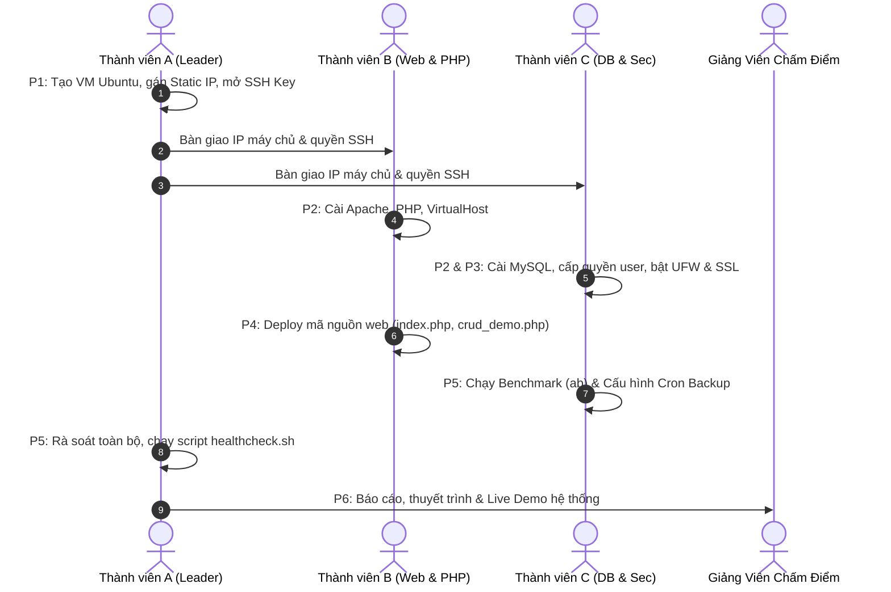

# Hướng Dẫn Triển Khai Hệ Thống LAMP Stack Từ A - Z (Deployment Guide)

> **Dự án**: Deployment and Configuration of a LAMP Stack Web Server on Ubuntu  
> **Mã đồ án**: `Linux_Oss`  
> **Phân công**: Thành viên A (Hạ tầng 35%), Thành viên B (Web & PHP 35%), Thành viên C (Database & Security 30%)

---

## 📌 Quy Trình Phối Hợp Tổng Quan (Workflow)



---

## GIAI ĐOẠN 1: Chuẩn Bị Hạ Tầng & Kết Nối (Thành viên A phụ trách)

### Bước 1.1: Khởi tạo máy ảo Ubuntu Server
* Khuyến nghị: Ubuntu Server 22.04 LTS hoặc 24.04 LTS trên VMware / VirtualBox.
* Cấu hình phần cứng tối thiểu:
  - RAM: 2048 MB (2 GB)
  - CPU: 2 vCPU
  - Ổ cứng: 20 GB
  - Network Adapter: Chọn chế độ **Bridged Adapter** (để máy chủ nhận cùng dải IP với máy thật và các bạn trong nhóm cùng truy cập được).

### Bước 1.2: Thiết lập mạng & Cập nhật hệ thống
Chạy script chuẩn bị môi trường:
```bash
chmod +x scripts/01_setup_environment.sh
sudo ./scripts/01_setup_environment.sh
```

### Bước 1.3: Cấu hình phân giải tên miền cục bộ
Ghi nhận địa chỉ IP của máy ảo (`hostname -I`). Trên máy tính của cả 3 thành viên, chỉnh sửa file `hosts`:
* **Trên Windows**: `C:\Windows\System32\drivers\etc\hosts` (Mở bằng Notepad với quyền Run as Administrator).
* **Trên Linux/macOS**: `/etc/hosts` (`sudo nano /etc/hosts`).

Thêm dòng sau vào cuối file:
```text
<IP_CỦA_MÁY_ẢO>    lamp.local www.lamp.local
```

---

## GIAI ĐOẠN 2 & 3: Cài Đặt Web Server & Ứng Dụng (Thành viên B phụ trách)

### Bước 2.1: Cài đặt Apache & PHP Runtime
Chạy script tự động của Thành viên B:
```bash
chmod +x scripts/02_install_core_lamp.sh
sudo ./scripts/02_install_core_lamp.sh
```

### Bước 2.2: Triển khai mã nguồn Web Demo
Sao chép mã nguồn từ repository vào DocumentRoot:
```bash
sudo cp -r src/* /var/www/lamp.local/public_html/
sudo chown -R www-data:www-data /var/www/lamp.local/public_html
sudo chmod -R 755 /var/www/lamp.local/public_html
```

Kiểm tra cú pháp VirtualHost:
```bash
sudo apache2ctl configtest
sudo systemctl reload apache2
```

---

## GIAI ĐOẠN 2, 3 & 5: CSDL, Bảo Mật, Sao Lưu & Đo Tải (Thành viên C phụ trách)

### Bước 3.1: Cài đặt MySQL Server, tối ưu và nạp CSDL
Chạy script tự động của Thành viên C:
```bash
chmod +x scripts/02_setup_database.sh
sudo ./scripts/02_setup_database.sh
```
*(Script sẽ tự động cài `mysql-server`, áp dụng file cấu hình tối ưu `configs/mysql/custom_mysqld.cnf`, tạo database `lamp_db`, user `lamp_user` và import bảng `students`).*

### Bước 3.2: Kiểm tra đăng nhập bằng tài khoản ứng dụng:
```bash
mysql -ulamp_user -pStrongPassword123 -e "USE lamp_db; SELECT * FROM students;"
```

### Bước 3.3: Cấu hình SSL, Tường lửa UFW & Fail2ban
Chạy script an ninh của Thành viên C:
```bash
chmod +x scripts/03_setup_security_ssl.sh
sudo ./scripts/03_setup_security_ssl.sh
```

### Bước 3.4: Thiết lập Cron Job Sao Lưu Tự Động
Chạy thử script backup:
```bash
sudo ./scripts/backup_lamp.sh
```

Thêm lịch sao lưu tự động mỗi ngày vào lúc 02:00 sáng qua crontab:
```bash
sudo crontab -e
```
Dán dòng sau vào cuối file crontab:
```text
0 2 * * * /home/buiduchoang/Desktop/Linux_Oss/scripts/backup_lamp.sh >> /var/log/lamp_backup.log 2>&1
```

### Bước 3.5: Đo kiểm hiệu năng chịu tải
```bash
./scripts/test_benchmark.sh https://lamp.local/
```

---

## GIAI ĐOẠN 5 & 6: Nghiệm Thu Toàn Diện & Demo (Thành viên A chủ trì)

### Bước 4.1: Chạy Healthcheck 1-Click
Thành viên A chạy script kiểm tra toàn diện để đảm bảo không còn lỗi tồn đọng:
```bash
./scripts/00_healthcheck.sh
```

### Bước 4.2: Thử nghiệm kịch bản phục hồi sự cố (Disaster Recovery)
Để gây ấn tượng với giảng viên, chạy thử kịch bản:
1. Xóa thử database hoặc file web.
2. Chạy script khôi phục tự động:
```bash
sudo ./scripts/restore_lamp.sh
```
3. Truy cập lại trình duyệt `https://lamp.local/crud_demo.php` để thấy toàn bộ dữ liệu nguyên vẹn!
