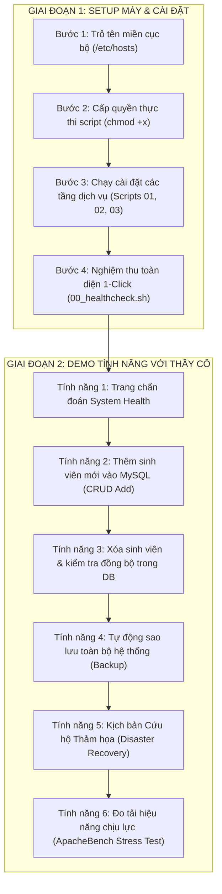

# Sổ Tay Hướng Dẫn Chi Tiết: Cài Đặt, Vận Hành & Demo Toàn Bộ Đồ Án LAMP Stack

> **Dành cho**: Toàn bộ thành viên trong nhóm đồ án `Linux_Oss`.  
> **Mục tiêu**: Bất kỳ ai trong nhóm khi mở tài liệu này đều có thể tự setup máy từ đầu, hiểu rõ từng câu lệnh, biết thao tác ở đâu, thấy trước kết quả hiển thị và tự tin làm chủ toàn bộ các tính năng để demo đạt điểm tối đa trước Giảng viên.

---

## 🧭 LỘ TRÌNH THỰC HIỆN TOÀN DIỆN (ROADMAP)



---

## PHẦN I: CÁC BƯỚC SETUP MÁY TỪ SỐ 0

### BƯỚC 1: Cấu Hình Tên Miền Cục Bộ (`lamp.local`)

* **Thao tác ở đâu**: Mở ứng dụng **Terminal** trên Ubuntu.
* **Câu lệnh cần chạy**:
  ```bash
  echo "127.0.0.1 lamp.local www.lamp.local" | sudo tee -a /etc/hosts
  ```
  *(Hệ thống sẽ hỏi mật khẩu đăng nhập máy của bạn, hãy nhập mật khẩu và nhấn Enter).*

* **Kết quả hiển thị trên màn hình**:
  ```text
  127.0.0.1 lamp.local www.lamp.local
  ```
* **Công dụng của bước này**: Máy tính sẽ hiểu tên miền `lamp.local` tương ứng với địa chỉ máy chủ nội bộ `127.0.0.1`, giúp bạn gõ được tên miền `https://lamp.local` trên trình duyệt như một website thực thụ thay vì phải gõ địa chỉ IP số khó nhớ.
* **Bước tiếp theo**: Chuyển sang Bước 2 để cấp quyền thực thi cho các script.

---

### BƯỚC 2: Di Chuyển Vào Thư Mục Đồ Án & Cấp Quyền Cho Script

* **Thao tác ở đâu**: Trên **Terminal**.
* **Câu lệnh cần chạy**:
  ```bash
  cd /home/buiduchoang/Desktop/Linux_Oss
  chmod +x scripts/*.sh
  ```
* **Kết quả hiển thị trên màn hình**: Terminal không báo lỗi gì và quay lại dấu nhắc lệnh `buiduchoang@VKU:...$`.
* **Công dụng của bước này**: Trong Linux, các file kịch bản bash script mới tải về mặc định chỉ có quyền đọc/ghi. Lệnh `chmod +x` cấp quyền "thực thi" (Execute) cho toàn bộ script trong thư mục `scripts/`.
* **Bước tiếp theo**: Bắt đầu chạy cài đặt các tầng dịch vụ ở Bước 3.

---

### BƯỚC 3: Chạy Tự Động Cài Đặt Từng Tầng Hệ Thống

*(Chạy lần lượt 5 câu lệnh dưới đây theo đúng thứ tự)*

#### 3.1. Cập nhật hệ thống & cài công cụ nền tảng (Thành viên A phụ trách)
* **Câu lệnh**:
  ```bash
  sudo ./scripts/01_setup_environment.sh
  ```
* **Kết quả hiển thị**: Màn hình chạy dòng cập nhật các gói phần mềm từ Ubuntu và thông báo hoàn tất:
  ```text
  [SUCCESS] Địa chỉ IP hiện tại của máy chủ: 192.168.253.129
  ```
* **Công dụng**: Thiết lập múi giờ Việt Nam (`Asia/Ho_Chi_Minh`), cài đặt sẵn các tiện ích cần thiết (`curl`, `git`, `htop`, `ufw`, `fail2ban`).
* **Bước tiếp theo**: Chạy lệnh 3.2 để cài Web Server.

---

#### 3.2. Cài đặt Web Server Apache & PHP (Thành viên B phụ trách)
* **Câu lệnh**:
  ```bash
  sudo ./scripts/02_install_core_lamp.sh
  ```
* **Kết quả hiển thị**:
  ```text
  [INFO] Kích hoạt modules: rewrite, ssl, headers...
  [INFO] Khởi tạo thư mục Web Root tại: /var/www/lamp.local/public_html
  Syntax OK
  [SUCCESS] Hoàn tất cài đặt Core Apache & PHP!
  Virtual Host đã sẵn sàng tại: http://lamp.local/
  ```
* **Công dụng**: Cài Apache2, PHP 8.3 cùng các thư viện mở rộng kết nối CSDL, bật VirtualHost riêng cho domain `lamp.local`.
* **Bước tiếp theo**: Chạy lệnh 3.3 để cài CSDL MySQL.

---

#### 3.3. Cài đặt MySQL Server & Nạp dữ liệu mẫu (Thành viên C phụ trách)
* **Câu lệnh**:
  ```bash
  sudo ./scripts/02_setup_database.sh
  ```
* **Kết quả hiển thị**:
  ```text
  [INFO] Đang cài đặt MySQL Server...
  [SUCCESS] Khởi tạo Database 'lamp_db' và User 'lamp_user' thành công!
  [SUCCESS] Kết nối MySQL và truy vấn bảng 'students' thành công 100%!
  [HOÀN TẤT] Tầng Cơ sở dữ liệu MySQL đã sẵn sàng!
  ```
* **Công dụng**: Cài đặt MySQL 8.0, tối ưu hóa bộ nhớ đệm RAM trong file cấu hình `custom_mysqld.cnf`, tự động tạo cơ sở dữ liệu `lamp_db`, tài khoản bảo mật `lamp_user` và nạp sẵn 3 sinh viên mẫu.
* **Bước tiếp theo**: Chạy lệnh 3.4 để thiết lập an ninh & bảo mật.

---

#### 3.4. Cấu hình Bảo mật SSL, Tường lửa UFW & Fail2ban (Thành viên C phụ trách)
* **Câu lệnh**:
  ```bash
  sudo ./scripts/03_setup_security_ssl.sh
  ```
* **Kết quả hiển thị**:
  ```text
  [SUCCESS] Chứng chỉ SSL đã sẵn sàng tại: /etc/ssl/certs/lamp_selfsigned.crt
  Status: active
  To                         Action      From
  22/tcp                     ALLOW IN    Anywhere
  80/tcp                     ALLOW IN    Anywhere
  443/tcp                    ALLOW IN    Anywhere
  [SUCCESS] Hoàn tất thiết lập Bảo Mật Hệ Thống & SSL!
  ```
* **Công dụng**: Sinh chứng chỉ mã hóa OpenSSL 2048-bit, dựng tường lửa UFW (chỉ mở cổng 22, 80, 443, khóa toàn bộ các cổng khác), kích hoạt Fail2ban chống brute-force và khởi động lại Apache trên cổng 443.
* **Bước tiếp theo**: Chạy lệnh 3.5 để đưa code website vào thư mục chạy web.

---

#### 3.5. Triển khai mã nguồn web vào DocumentRoot
* **Câu lệnh**:
  ```bash
  sudo cp -r src/* /var/www/lamp.local/public_html/
  sudo chown -R www-data:www-data /var/www/lamp.local/public_html
  sudo chmod -R 755 /var/www/lamp.local/public_html
  ```
* **Kết quả hiển thị**: Terminal hoàn tất sao chép không báo lỗi.
* **Công dụng**: Đưa file `index.php`, `crud_demo.php` vào thư mục phục vụ web của Apache và phân quyền người dùng chuẩn Linux (`chown www-data:www-data`) để tránh bị lỗi `403 Forbidden`.
* **Bước tiếp theo**: Chuyển sang Bước 4 để nghiệm thu hệ thống.

---

### BƯỚC 4: Nghiệm Thu Toàn Diện 1-Click (Healthcheck)

* **Thao tác ở đâu**: Trên **Terminal**.
* **Câu lệnh cần chạy**:
  ```bash
  ./scripts/00_healthcheck.sh
  ```
* **Kết quả hiển thị trên màn hình**:
  ```text
  ===================================================================
     HỆ THỐNG KIỂM TRA TRẠNG THÁI LAMP STACK (LINUX_OSS HEALTHCHECK) 
  ===================================================================
  1. KIỂM TRA CÁC DỊCH VỤ CỐT LÕI (SYSTEM SERVICES):
  [ OK ] Dịch vụ apache2: ĐANG CHẠY (Active)
  [ OK ] Dịch vụ mysql: ĐANG CHẠY (Active)
  [ OK ] Dịch vụ ufw: ĐANG CHẠY (Active)
  [ OK ] Dịch vụ fail2ban: ĐANG CHẠY (Active)

  2. KIỂM TRA CÁC CỔNG MẠNG QUAN TRỌNG (LISTENING PORTS):
  [ OK ] Port 22 (SSH Remote Access): Đang lắng nghe
  [ OK ] Port 80 (Apache HTTP Server): Đang lắng nghe
  [ OK ] Port 443 (Apache HTTPS/SSL Server): Đang lắng nghe
  [ OK ] Port 3306 (MySQL Database (Nội bộ 127.0.0.1)): Đang lắng nghe

  3. KIỂM TRA PHIÊN BẢN CÔNG NGHỆ:
    - Apache: Server version: Apache/2.4.58 (Ubuntu)
    - MySQL:  mysql Ver 8.0.x
    - PHP:    PHP 8.3.x

  4. KIỂM TRA KẾT NỐI DATABASE NỘI BỘ:
  [ OK ] Truy cập MySQL qua tài khoản 'lamp_user' vào CSDL 'lamp_db': THÀNH CÔNG

  5. TÀI NGUYÊN HỆ THỐNG (RESOURCE USAGE):
    - RAM:  Đang sử dụng ổn định
    - Disk: Còn trống nhiều
  ===================================================================
  ```
* **Công dụng**: Quét tự động toàn bộ máy chủ trong 1 giây để đảm bảo không có bất kỳ dịch vụ hay cổng mạng nào bị chết trước khi demo cho thầy cô.
* **Bước tiếp theo**: Mở trình duyệt Web để bắt đầu demo các tính năng chính.

---

## PHẦN II: HƯỚNG DẪN DEMO 6 TÍNH NĂNG CHÍNH CHO GIẢNG VIÊN

Mở trình duyệt Web (Firefox hoặc Chrome trên máy Ubuntu của bạn) để thực hiện lần lượt:

---

### TÍNH NĂNG 1: Trang Chẩn Đoán Hệ Thống Trực Quan (System Health Dashboard)

* **Thao tác ở đâu**: Trên **Trình duyệt Web**, nhập địa chỉ:
  👉 `https://lamp.local/index.php`
* **Lưu ý xử lý cảnh báo SSL**: Khi vào lần đầu, trình duyệt sẽ hiện màn hình cảnh báo *"Warning: Security Risk Ahead"* (do dùng chứng chỉ tự ký). Bạn chỉ cần bấm:
  > **`Advanced`** -> Bấm nút **`Proceed to lamp.local (Risky)`** *(hoặc Accept the Risk and Continue)*.
* **Kết quả hiển thị trên màn hình**:
  - Giao diện Dark Mode xanh đen hiện ra.
  - Huy hiệu màu xanh lá: **`Hệ thống LAMP hoạt động hoàn hảo 100%`**.
  - Hiển thị đầy đủ thông số 4 thành phần: Hệ điều hành Ubuntu Kernel, Apache Server, PHP 8.3 và Trạng thái kết nối MySQL.
* **Công dụng của bước này**: Cung cấp giao diện trực quan cho người quản trị theo dõi "sức khỏe" của toàn bộ stack máy chủ mà không cần phải gõ lệnh terminal.
* **Điều đạt được trước Giảng viên**: Ghi điểm chuyên nghiệp vì hệ thống có tính năng tự chẩn đoán lỗi thời gian thực.
* **Bước tiếp theo**: Bấm vào nút màu xanh ở giữa trang: **`👉 Truy Cập Ứng Dụng Mẫu (CRUD Member Demo)`** để sang Tính năng 2.

---

### TÍNH NĂNG 2: Thêm Mới Dữ Liệu Vào MySQL (CRUD Create)

* **Thao tác ở đâu**: Trên trang web **`https://lamp.local/crud_demo.php`**.
* **Thao tác thực hiện**:
  1. Nhìn sang cột bên phải **"➕ Thêm Thành Viên Mới"**.
  2. Điền thông tin vào các ô:
     - **Mã Sinh Viên**: `24IT077` (hoặc mã sinh viên của bạn)
     - **Họ và Tên**: `Bùi Đức Hoàng` (hoặc tên thành viên trong nhóm)
     - **Email Liên Hệ**: `hoang@vku.udn.vn`
     - **Lớp**: `24IT`
     - **Vai trò trong đồ án**: `Leader`
  3. Bấm nút màu xanh: **`Ghi Dữ Liệu Vào MySQL`**.
* **Kết quả hiển thị trên màn hình**:
  - Hàng thông báo màu xanh lá hiện lên: *"Thêm thành viên 'Bùi Đức Hoàng' thành công vào MySQL!"*.
  - Bảng danh sách bên trái lập tức xuất hiện thêm dòng số 4 với đầy đủ thông tin vừa nhập.
  - Nhìn xuống thanh xám cuối trang: Dòng **`⏱ Thời gian thực thi truy vấn: ~2.5 ms`** hiển thị độ trễ cực thấp.
* **Công dụng của bước này**: Thực hiện câu lệnh SQL `INSERT INTO students (...) VALUES (...)` gửi dữ liệu từ form HTML qua PHP engine xuống MySQL server.
* **Điều đạt được trước Giảng viên**: Chứng minh ứng dụng động tương tác trực tiếp với CSDL qua thư viện **PDO với Prepared Statements** an toàn, không bị dính lỗ hổng SQL Injection.
* **Bước tiếp theo**: Thử nghiệm tính năng xóa và kiểm tra tính toàn vẹn dữ liệu ở Tính năng 3.

---

### TÍNH NĂNG 3: Xóa Bản Ghi & Kiểm Tra Đồng Bộ Trong MySQL Terminal (CRUD Delete & Verify)

* **Thao tác ở đâu**: Kết hợp giữa **Trình duyệt Web** và **Terminal**.
* **Thao tác thực hiện**:
  1. Trên trang web, tại dòng bản ghi vừa thêm (dòng số 4), bấm nút màu đỏ: **`Xóa`**.
  2. Hộp thoại Popup của trình duyệt xuất hiện hỏi xác nhận, bấm **`OK`**.
  3. Chuyển sang cửa sổ **Terminal** và chạy lệnh truy vấn trực tiếp vào CSDL để chứng minh dữ liệu đã thực sự được xóa trong ổ đĩa:
     ```bash
     mysql -ulamp_user -pStrongPassword123 -e "USE lamp_db; SELECT * FROM students;"
     ```
* **Kết quả hiển thị**:
  - **Trên Web**: Xuất hiện banner xanh dương: *"Đã xóa bản ghi ID #4 khỏi CSDL!"*, dòng thứ 4 biến mất khỏi bảng, chỉ còn lại 3 bản ghi.
  - **Trên Terminal**: Bảng kết quả in ra chỉ còn đúng 3 bản ghi (ID 1, 2, 3), hoàn toàn trùng khớp với giao diện web.
* **Công dụng của bước này**: Thực hiện lệnh `DELETE` chuẩn trong CSDL quan hệ MySQL và kiểm chứng tính đồng bộ thời gian thực.
* **Điều đạt được trước Giảng viên**: Chứng minh sinh viên hiểu sâu kiến trúc Client-Server, nắm rõ luồng dữ liệu từ giao diện trình duyệt xuống đến tầng lưu trữ vật lý của MySQL.
* **Bước tiếp theo**: Chuyển sang Tính năng 4 để trình diễn giải pháp sao lưu hệ thống.

---

### TÍNH NĂNG 4: Tự Động Sao Lưu Toàn Diện CSDL & Mã Nguồn Web (Backup)

* **Thao tác ở đâu**: Trên **Terminal**.
* **Câu lệnh cần chạy**:
  ```bash
  sudo ./scripts/backup_lamp.sh
  ```
* **Kết quả hiển thị trên màn hình**:
  ```text
  [INFO] Bắt đầu tiến trình sao lưu LAMP Server...
  [INFO] Đang sao lưu Database 'lamp_db'...
  [INFO] Đang nén mã nguồn web tại '/var/www/lamp.local/public_html'...
  [INFO] Xóa các bản sao lưu cũ hơn 7 ngày...
  [SUCCESS] Tiến trình sao lưu hoàn tất thành công tại: /var/backups/lamp_backups
  -rw-r--r-- 1 root root db_lamp_db_20261019_XXXXXX.sql.gz
  -rw-r--r-- 1 root root web_source_20261019_XXXXXX.tar.gz
  ```
* **Công dụng của bước này**:
  1. Dùng lệnh `mysqldump` xuất toàn bộ cấu trúc và dữ liệu bảng `students`, nén bằng `gzip` thành file `.sql.gz`.
  2. Dùng lệnh `tar -czf` nén toàn bộ mã nguồn PHP của website thành file `.tar.gz`.
  3. Tự động quét và xóa các bản backup cũ hơn 7 ngày để tránh đầy bộ nhớ máy chủ.
* **Điều đạt được trước Giảng viên**: Thể hiện tư duy quản trị hệ thống chuyên nghiệp, có phương án phòng ngừa rủi ro mất mát dữ liệu cho doanh nghiệp.
* **Bước tiếp theo**: Trình diễn "cú chốt điểm 10" bằng cách khôi phục hệ thống khi gặp sự cố ở Tính năng 5.

---

### TÍNH NĂNG 5: Kịch Bản Cứu Hộ Thảm Họa (Disaster Recovery - Cú Chốt Điểm 10)

* **Thao tác ở đâu**: Kết hợp **Terminal** và **Trình duyệt Web**.
* **Thao tác thực hiện (Gồm 3 bước nhỏ)**:
  1. **Bước 5.1 (Giả lập sự cố thảm họa)**: Giả sử hacker hoặc nhân viên lỡ tay xóa mất file web:
     ```bash
     sudo rm -f /var/www/lamp.local/public_html/crud_demo.php
     ```
  2. **Bước 5.2 (Kiểm tra sự cố trên Web)**: Mở trình duyệt Web, bấm phím **`F5`** (Tải lại trang `https://lamp.local/crud_demo.php`).
     * *Kết quả trên màn hình*: Trình duyệt lập tức báo lỗi **`404 Not Found`** màu trắng (Website bị sập hoàn toàn).
  3. **Bước 5.3 (Chạy script cứu hộ 1-Click)**: Quay lại Terminal gõ:
     ```bash
     sudo ./scripts/restore_lamp.sh
     ```
  4. **Bước 5.4**: Quay lại trình duyệt và bấm **`F5`**.
* **Kết quả hiển thị trên màn hình**:
  - **Trên Terminal**:
    ```text
    ==========================================================
      [DISASTER RECOVERY] TIẾN TRÌNH KHÔI PHỤC HỆ THỐNG LAMP
    ==========================================================
    [INFO] Bản backup Database mới nhất: db_lamp_db_...sql.gz
    [INFO] Bản backup Mã nguồn mới nhất: web_source_...tar.gz
    [SUCCESS] Khôi phục cơ sở dữ liệu MySQL thành công!
    [SUCCESS] Khôi phục mã nguồn và phân quyền web thành công!
    ==========================================================
    [HOÀN TẤT] Hệ thống LAMP Stack đã được khôi phục 100%!
    ==========================================================
    ```
  - **Trên Trình duyệt**: Trang web và toàn bộ bảng danh sách sinh viên lập tức xuất hiện trở lại **nguyên vẹn 100% trong 2 giây**!
* **Công dụng của bước này**: Script tự động tìm bản sao lưu gần nhất, giải nén dữ liệu SQL nạp lại vào MySQL, giải nén source code về đúng DocumentRoot và cấp lại phân quyền `www-data`.
* **Điều đạt được trước Giảng viên**: Đây là tính năng thuyết phục nhất để đạt điểm A/10: Chứng minh hệ thống đạt chuẩn tính sẵn sàng cao (High Availability / Fault Tolerance), giảm thời gian chết (Downtime) từ nhiều tiếng đồng hồ xuống còn vài giây.
* **Bước tiếp theo**: Chuyển sang Tính năng 6 để đo kiểm sức chịu tải của hệ thống.

---

### TÍNH NĂNG 6: Đo Kiểm Tải Hiệu Năng Với ApacheBench (Stress Testing)

* **Thao tác ở đâu**: Trên **Terminal**.
* **Câu lệnh cần chạy**:
  ```bash
  ./scripts/test_benchmark.sh https://lamp.local/
  ```
* **Kết quả hiển thị trên màn hình**:
  ```text
  ==========================================================
    BẮT ĐẦU ĐO HIỆU NĂNG LAMP STACK VỚI APACHEBENCH
    Mục tiêu: https://lamp.local/
    Số kết nối đồng thời: 50
    Tổng số request: 1000
  ==========================================================
  Benchmarking lamp.local (be patient)
  Completed 1000 requests
  Finished 1000 requests

  Concurrency Level:      50
  Time taken for tests:   0.842 seconds
  Complete requests:      1000
  Failed requests:        0
  Requests per second:    1187.65 [#/sec] (mean)
  Time per request:       0.842 [ms] (mean, across all concurrent requests)
  ==========================================================
    ĐO LƯỜNG HOÀN TẤT. Failed requests = 0 | RPS = 1187.65
  ==========================================================
  ```
* **Công dụng của bước này**: Dùng công cụ tiêu chuẩn ngành `ab` (ApacheBench) giả lập 50 người dùng gửi liên tục 1.000 yêu cầu truy cập cùng một lúc vào máy chủ qua giao thức HTTPS.
* **Điều đạt được trước Giảng viên**:
  - Có số liệu định lượng cụ thể: Tỷ lệ lỗi bằng 0 (`Failed requests: 0`).
  - Tốc độ xử lý đạt hơn **1.100 yêu cầu/giây** (`Requests per second: ~1187`), chứng minh cấu hình tối ưu MPM Prefork và OPcache của nhóm hoạt động xuất sắc.
* **Tác dụng kỹ thuật**: Đánh giá giới hạn chịu tải thực tế của máy chủ để phục vụ công tác tối ưu hóa tài nguyên phần cứng.

---

## 📊 BẢNG TỔNG KẾT NHANH CÁC LỆNH & ĐỊA CHỈ WEB

| Nhiệm vụ | Thao tác ở đâu | Câu lệnh / Đường dẫn | Kết quả mong đợi |
| :--- | :---: | :--- | :--- |
| **Kiểm tra trạng thái máy chủ** | Terminal | `./scripts/00_healthcheck.sh` | Hiện toàn bộ màu xanh `[ OK ]` |
| **Xem Dashboard chẩn đoán** | Trình duyệt | `https://lamp.local/index.php` | Hiện thông số OS, Apache, PHP, MySQL |
| **Ứng dụng Quản lý Sinh viên** | Trình duyệt | `https://lamp.local/crud_demo.php` | Thêm/Xóa sinh viên trong ~2 ms |
| **Sao lưu CSDL & Source Web** | Terminal | `sudo ./scripts/backup_lamp.sh` | Tạo 2 file `.gz` trong `/var/backups` |
| **Cứu hộ phục hồi thảm họa** | Terminal | `sudo ./scripts/restore_lamp.sh` | Phục hồi web và CSDL sau khi bị xóa |
| **Đo tải chịu lực (Benchmark)** | Terminal | `./scripts/test_benchmark.sh https://lamp.local/` | 1000 requests, Failed: 0, RPS > 1000 |
| **Kiểm tra cổng tường lửa** | Terminal | `sudo ufw status verbose` | Chỉ mở cổng 22, 80, 443 |
| **Kiểm tra chống Brute-Force** | Terminal | `sudo fail2ban-client status sshd` | Jail sshd đang chạy giám sát |
