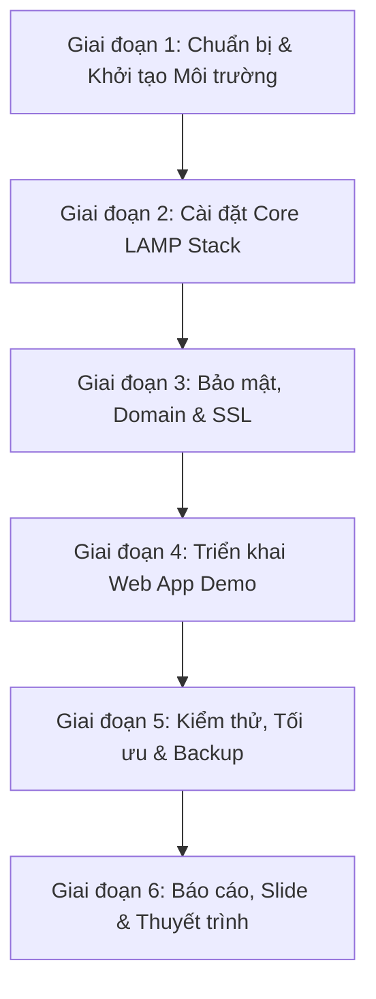
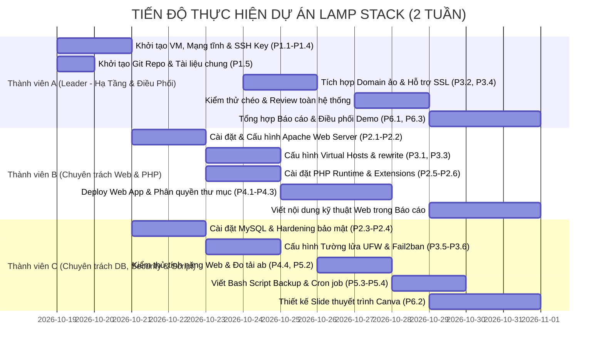

# Kế Hoạch Triển Khai Đề Tài: Cài Đặt & Cấu Hình LAMP Stack Web Server trên Ubuntu

---

## I. Tổng Quan Tech Stack & Danh Sách Công Cụ Cần Thiết

### 1. Thành Phần Cốt Lõi (Core LAMP Stack)
| Thành phần | Công nghệ khuyến nghị | Phiên bản khuyến nghị | Mục đích sử dụng |
| :--- | :--- | :--- | :--- |
| **L** (Linux) | **Ubuntu Server** | 22.04 LTS hoặc 24.04 LTS | Hệ điều hành nền tảng cho máy chủ |
| **A** (Apache) | **Apache HTTP Server** | 2.4.x | Web server phục vụ HTTP/HTTPS request, Virtual Hosts |
| **M** (MySQL) | **MySQL Server / MariaDB** | MySQL 8.0+ hoặc MariaDB 10.11+ | Hệ quản trị cơ sở dữ liệu quan hệ lưu trữ dữ liệu web |
| **P** (PHP) | **PHP** + FPM/Modules | PHP 8.2 hoặc 8.3 | Ngôn ngữ kịch bản xử lý logic backend động |

### 2. Công Cụ & Thư Viện Hỗ Trợ Kỹ Thuật
- **Môi trường ảo hóa / Triển khai**:
  - *Môi trường Local*: Oracle VirtualBox hoặc VMware Workstation Player (cấu hình Card mạng Bridged Adapter để truy cập IP từ máy host).
  - *Môi trường Cloud*: AWS EC2 (t2.micro / Ubuntu), DigitalOcean Droplet, hoặc Google Cloud Compute Engine.
- **Quản trị từ xa & Truyền file**:
  - `OpenSSH Server`: Truy cập shell từ xa (`ssh user@server_ip`).
  - `Termius`, `MobaXterm`, hoặc `VS Code Remote - SSH` extension.
  - `WinSCP` / `FileZilla`: Hỗ trợ thành viên kéo thả file web/config.
- **Bảo mật & Tường lửa**:
  - `UFW (Uncomplicated Firewall)`: Giới hạn port mở (chỉ cho phép 22, 80, 443).
  - `Fail2ban`: Chống brute-force tấn công SSH.
  - `Certbot` (Let's Encrypt) hoặc OpenSSL (tạo Self-Signed Certificate nếu chỉ chạy mạng nội bộ LAN).
- **Ứng dụng Web mẫu để Demo**:
  - Lựa chọn 1 (Khuyên dùng): **WordPress** (chứng minh LAMP hoạt động hoàn hảo với CMS thực tế).
  - Lựa chọn 2: Ứng dụng **CRUD PHP thuần** (kết nối PDO/MySQLi hiển thị danh sách sinh viên/sản phẩm) + **phpMyAdmin**.
- **Công cụ Kiểm thử & Giám sát**:
  - `ApacheBench (ab)` hoặc `wrk`: Đo lường tải (Stress testing/Benchmark).
  - `htop`, `systemd` (`systemctl status`), log watchers (`tail -f /var/log/apache2/error.log`).

---

## II. Bản Kế Hoạch 1: Kế Hoạch Chi Tiết Từng Giai Đoạn (Milestones & Work Breakdown)

### Giai đoạn 1: Chuẩn bị & Thiết lập Môi trường (Mã: `P1`)
* **Mục tiêu**: Chuẩn bị sẵn sàng hạ tầng máy chủ và kết nối mạng thông suốt.
* **Các bước chi tiết**:
  - `P1.1`: Tạo máy ảo Ubuntu Server 22.04/24.04 LTS (RAM >= 2GB, Ổ cứng >= 20GB, 2 vCPU).
  - `P1.2`: Cấu hình Card mạng (Bridged Networking hoặc Static IP) để các máy khác trong cùng mạng LAN truy cập được.
  - `P1.3`: Cập nhật hệ thống (`sudo apt update && sudo apt upgrade -y`).
  - `P1.4`: Tạo user quản trị có quyền `sudo` riêng, tắt đăng nhập `root` qua SSH và thiết lập SSH Key Authentication.
  - `P1.5`: Lập repository Git để lưu trữ tài liệu, script cài đặt và file cấu hình (Config templates).

### Giai đoạn 2: Cài đặt & Cấu hình Core LAMP Stack (Mã: `P2`)
* **Mục tiêu**: Cài đặt thành công 4 thành phần Linux - Apache - MySQL - PHP và đảm bảo chúng kết nối thông suốt.
* **Các bước chi tiết**:
  - `P2.1`: Cài đặt Apache Web Server (`apache2`), kích hoạt khởi động cùng hệ thống (`systemctl enable apache2`).
  - `P2.2`: Kiểm tra Default Page của Apache qua IP trình duyệt.
  - `P2.3`: Cài đặt MySQL Server (`mysql-server`), chạy script bảo mật `sudo mysql_secure_installation`.
  - `P2.4`: Khởi tạo database, user phân quyền cho ứng dụng demo (không dùng quyền root cho app).
  - `P2.5`: Cài đặt PHP cùng các extension quan trọng (`php`, `libapache2-mod-php`, `php-mysql`, `php-curl`, `php-gd`, `php-mbstring`, `php-xml`).
  - `P2.6`: Tạo file kiểm tra `info.php` (`phpinfo();`) để xác nhận Apache đã parse được mã PHP và nhận diện module MySQL. Sau đó xóa file `info.php` để đảm bảo an toàn.

### Giai đoạn 3: Cấu hình Virtual Hosts, Tên Miền & Bảo Mật (Mã: `P3`)
* **Mục tiêu**: Máy chủ phục vụ tên miền ảo độc lập, mã hóa SSL và được bảo vệ bởi tường lửa.
* **Các bước chi tiết**:
  - `P3.1`: Cấu hình file Virtual Host (`/etc/apache2/sites-available/lamp.local.conf`) với `DocumentRoot`, `ServerName`, `ServerAlias`, `ErrorLog`, `CustomLog`.
  - `P3.2`: Cấu hình file `hosts` cục bộ trên máy trỏ về IP máy chủ (ví dụ: `192.168.1.50 lamp.local`).
  - `P3.3`: Kích hoạt Virtual Host (`a2ensite lamp.local.conf`), kích hoạt `mod_rewrite` (`a2enmod rewrite`), tắt default site.
  - `P3.4`: Cấu hình SSL/TLS (Certbot hoặc OpenSSL Self-Signed Certificate).
  - `P3.5`: Cấu hình Tường lửa UFW: Chỉ mở port 22 (SSH), 80 (HTTP), 443 (HTTPS), chặn tất cả các port còn lại.
  - `P3.6`: Cài đặt và cấu hình `Fail2ban` để tự động ban IP vi phạm SSH login quá 5 lần.

### Giai đoạn 4: Triển khai Ứng dụng Web Demo & Kết nối CSDL (Mã: `P4`)
* **Mục tiêu**: Chứng minh hệ thống phục vụ được ứng dụng thực tế có đọc/ghi CSDL.
* **Các bước chi tiết**:
  - `P4.1`: Tải và giải nén source code ứng dụng (WordPress hoặc Source CRUD PHP tự viết) vào thư mục web (`/var/www/lamp.local/public_html`).
  - `P4.2`: Phân quyền chính xác cho thư mục web (`chown -R www-data:www-data`, `chmod -R 755/644`).
  - `P4.3`: Cấu hình kết nối cơ sở dữ liệu (`wp-config.php` hoặc `config.php`).
  - `P4.4`: Chạy cài đặt web app, tạo bài viết, tải ảnh mẫu, kiểm tra tính năng upload và tương tác DB.

### Giai đoạn 5: Tối ưu Hóa, Kiểm Thử Chịu Tải & Sao Lưu (Mã: `P5`)
* **Mục tiêu**: Đảm bảo máy chủ hoạt động ổn định, đo lường hiệu năng và có giải pháp dự phòng dữ liệu.
* **Các bước chi tiết**:
  - `P5.1`: Tối ưu hóa cấu hình Apache MPM và tham số PHP (`memory_limit`, `upload_max_filesize`).
  - `P5.2`: Sử dụng `ApacheBench` (`ab -n 1000 -c 50 https://...`) để kiểm tra RPS và thời gian phản hồi.
  - `P5.3`: Viết Bash script tự động Backup (`mysqldump` + `tar`) và lên lịch qua `cron job`.
  - `P5.4`: Thử nghiệm kịch bản Disaster Recovery: Xóa thử DB và chạy script khôi phục.

### Giai đoạn 6: Hoàn Thiện Hồ Sơ Đồ Án, Slide & Thuyết Trình (Mã: `P6`)
* **Mục tiêu**: Đầy đủ báo cáo đồ án đúng chuẩn học thuật, slide đẹp mắt và kịch bản demo mượt mà.
* **Các bước chi tiết**:
  - `P6.1`: Tổng hợp sơ đồ kiến trúc, tài liệu cấu hình, lệnh terminal, ảnh chụp từng bước vào Báo cáo Word.
  - `P6.2`: Thiết kế Slide thuyết trình (PowerPoint/Canva) gồm: Đặt vấn đề, Kiến trúc hệ thống, Demo tính năng, Kết quả kiểm thử, Bài học kinh nghiệm.
  - `P6.3`: Chuẩn bị kịch bản demo trực tiếp cho thầy/cô (Live Demo Checklist).

---

## III. Bản Kế Hoạch 2: Phân Chia Nhiệm Vụ Theo Nhân Sự (3 Người)

> **Nguyên tắc phân bổ công việc**:
> - **Thành viên A (Nhóm trưởng - Leader)**: Khối lượng công việc ~35%, tập trung vào khởi tạo hạ tầng nền tảng, thiết lập môi trường dùng chung ban đầu, tích hợp hệ thống, rà soát kiểm thử chéo và điều phối chung hồ sơ báo cáo/thuyết trình.
> - **Thành viên B (Chuyên trách Web Server & PHP)**: Khối lượng công việc ~35%, đảm nhận toàn bộ luồng Web Server (Apache), Virtual Hosts, môi trường xử lý PHP và triển khai ứng dụng Web mẫu.
> - **Thành viên C (Chuyên trách Database, Bảo mật & Tự động hóa)**: Khối lượng công việc ~30%, đảm nhận toàn bộ luồng CSDL MySQL, an toàn mạng (UFW, Fail2ban), viết kịch bản Bash tự động hóa sao lưu (Backup) và đo kiểm chịu tải (Benchmark), hỗ trợ thiết kế slide.

### Bảng Mô Tả Chi Tiết Nhiệm Vụ Từng Thành Viên:

#### 1. Thành viên A (Nhóm trưởng / Hạ Tầng & Điều Phối - Khối lượng: ~35%)
* **Vai trò**: Quản trị dự án, thiết lập nền móng hạ tầng, tích hợp mạng & tên miền, rà soát nghiệm thu và điều phối báo cáo.
* **Các nhiệm vụ cụ thể**:
  - `P1.1 - P1.4`: Tạo máy ảo Ubuntu Server, cấu hình card mạng (Bridged/Static IP), tạo user `sudo`, thiết lập SSH Key Authentication và tắt login root.
  - `P1.5`: Khởi tạo Repository GitHub lưu trữ tài liệu, config template, script bash dùng chung cho cả nhóm.
  - `P3.2, P3.4`: Phối hợp cấu hình file `hosts` phân giải domain ảo nội bộ và hỗ trợ tạo chứng chỉ SSL/TLS (Self-signed/Certbot).
  - `P5.1 (Review)`: Kiểm thử chéo (Cross-testing) toàn bộ hệ thống sau khi B và C hoàn tất, phát hiện lỗi xung đột cổng hoặc quyền truy cập.
  - `P6.1 (Lead) & P6.3`: Xây dựng đề cương báo cáo Word, tổng hợp và chuẩn hóa nội dung kỹ thuật từ B & C thành bản báo cáo cuối cùng; chủ trì kịch bản Live Demo và phân bổ câu hỏi vấn đáp bảo vệ đồ án.

#### 2. Thành viên B (Chuyên trách Web Server & PHP - Khối lượng: ~36%)
* **Vai trò**: Xây dựng tầng máy chủ web (Web Server Layer), môi trường thông dịch PHP và triển khai ứng dụng web demo.
* **Các nhiệm vụ cụ thể**:
  - `P2.1 - P2.2`: Cài đặt Apache Web Server, bật khởi động cùng OS, kiểm tra trang Welcome mặc định.
  - `P2.5 - P2.6`: Cài đặt PHP cùng các modules cần thiết (`libapache2-mod-php`, `php-mysql`, `php-curl`, `php-gd`, `php-mbstring`, `php-xml`), test xử lý PHP với Apache bằng `info.php`.
  - `P3.1, P3.3`: Cấu hình Virtual Hosts độc lập (`/etc/apache2/sites-available/lamp.local.conf`), kích hoạt `mod_rewrite`, trỏ `DocumentRoot` và phân tách log hệ thống.
  - `P4.1 - P4.3`: Triển khai Source Code Web App mẫu (WordPress hoặc PHP CRUD), phân quyền thư mục chuẩn Linux (`chown www-data`, `chmod 755/644`), cấu hình file kết nối CSDL (`config.php`).
  - `P6.1 (Tech Docs)`: Soạn thảo toàn bộ phần thuyết minh kỹ thuật và chụp ảnh terminal các bước cài đặt/cấu hình Apache, PHP và Web App cho Báo cáo.

#### 3. Thành viên C (Chuyên trách Database, Bảo mật & Tự động hóa - Khối lượng: ~36%)
* **Vai trò**: Xây dựng tầng cơ sở dữ liệu (Database Layer), thiết lập an toàn mạng, viết kịch bản tự động hóa và đo lường hiệu năng.
* **Các nhiệm vụ cụ thể**:
  - `P2.3 - P2.4`: Cài đặt MySQL Server, chạy `mysql_secure_installation`, khởi tạo database, cấp quyền tài khoản chuyên biệt cho Web App.
  - `P3.5 - P3.6`: Thiết lập tường lửa UFW (chỉ mở các port 22, 80, 443), cài đặt & cấu hình `Fail2ban` phòng chống brute-force SSH.
  - `P4.4`: Chạy thử nghiệm các tính năng thêm/sửa/xóa dữ liệu và tải file trên Web App, kiểm tra ghi nhận trong CSDL MySQL.
  - `P5.2`: Sử dụng công cụ `ApacheBench (ab)` để đo tải hiệu năng (RPS, Concurrency, Latency), xuất dữ liệu thống kê.
  - `P5.3 - P5.4`: Viết Bash Script sao lưu tự động (mysqldump + nén tar) và lên lịch chạy định kỳ bằng `cron job`, thử nghiệm kịch bản phục hồi khi xảy ra sự cố.
  - `P6.2`: Thiết kế Slide thuyết trình hoàn chỉnh (trên Canva hoặc PowerPoint); soạn thảo phần thuyết minh kỹ thuật về MySQL, UFW/Fail2ban, Backup và Benchmark cho Báo cáo.

---

## IV. Bảng Ma Trận Liên Kết Trách Nhiệm (RACI Matrix)

*Quy ước: **R** (Responsible - Người thực hiện chính), **A** (Accountable - Người chịu trách nhiệm/duyệt), **C** (Consulted - Người hỗ trợ/phối hợp), **I** (Informed - Người nhận thông tin bàn giao).*

| Mã Task | Tên Công Việc | Giai Đoạn | Phụ Trách (R) | Duyệt (A) | Hỗ Trợ (C) | Nhận Bàn Giao (I) |
| :---: | :--- | :---: | :---: | :---: | :---: | :---: |
| **P1.1 - P1.4** | Tạo VM Ubuntu, Cấu hình Mạng tĩnh, SSH Key & Sudo User | Giai đoạn 1 | **A (Leader)** | A | B, C | B, C |
| **P1.5** | Khởi tạo Git Repo & Workspace chung | Giai đoạn 1 | **A (Leader)** | A | B, C | Toàn nhóm |
| **P2.1 - P2.2** | Cài đặt & Kích hoạt Apache Web Server | Giai đoạn 2 | **B** | A | A | C (nắm port) |
| **P2.3 - P2.4** | Cài đặt MySQL, Chạy Secure Script & Tạo DB/User | Giai đoạn 2 | **C** | A | A | B (lấy info DB) |
| **P2.5 - P2.6** | Cài đặt PHP & Các Extensions kết nối Apache-MySQL | Giai đoạn 2 | **B** | A | C | A |
| **P3.1, P3.3** | Cấu hình Virtual Hosts độc lập & `mod_rewrite` | Giai đoạn 3 | **B** | A | A | C |
| **P3.2, P3.4** | Phân giải Domain ảo nội bộ (`hosts`) & SSL/TLS | Giai đoạn 3 | **A (Leader)** | A | B | B, C |
| **P3.5 - P3.6** | Cấu hình Tường lửa UFW & Dịch vụ Fail2ban | Giai đoạn 3 | **C** | A | A | B |
| **P4.1 - P4.3** | Deploy Source Code Web App & Phân quyền `www-data` | Giai đoạn 4 | **B** | A | C (DB info) | A |
| **P4.4** | Kiểm thử chức năng nghiệp vụ Web & Dữ liệu DB | Giai đoạn 4 | **C** | A | B | A |
| **P5.1** | Tối ưu hóa Apache MPM, PHP Config & Kiểm thử chéo | Giai đoạn 5 | **A (Leader)** | A | B | B, C |
| **P5.2** | Đo lường hiệu năng, Stress Testing với ApacheBench (`ab`) | Giai đoạn 5 | **C** | A | B | Toàn nhóm |
| **P5.3 - P5.4** | Viết Bash Script Tự động Backup & Phục hồi (Cron job) | Giai đoạn 5 | **C** | A | B | A |
| **P6.1** | Biên soạn Báo cáo Đồ án hoàn chỉnh (Word/PDF) | Giai đoạn 6 | **Cả 3 (A Lead)** | A | B, C | Giảng viên |
| **P6.2** | Thiết kế Slide Thuyết trình (Canva/PowerPoint) | Giai đoạn 6 | **C** | A | A, B | Toàn nhóm |
| **P6.3** | Chuẩn bị Kịch bản Live Demo & Luyện tập Vấn đáp | Giai đoạn 6 | **A (Leader)** | A | B, C | Giảng viên |
