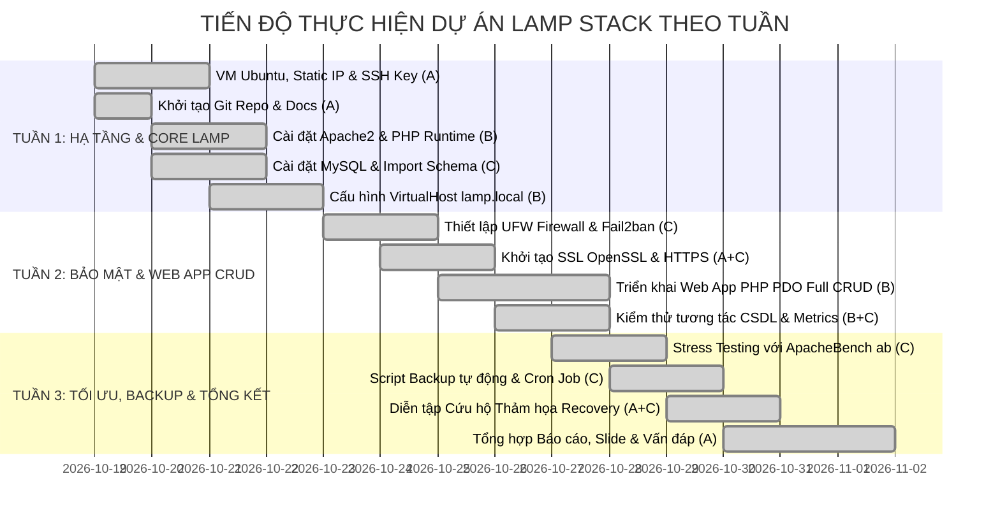

# BÁO CÁO TỔNG QUAN TIẾN ĐỘ DỰ ÁN (MASTER PROGRESS REPORT)

* **Tên Đề Tài**: Deployment and Configuration of a LAMP Stack Web Server on Ubuntu
* **Mã Dự Án**: `Linux_Oss`
* **Kho lưu trữ (Repository)**: [GitHub Hoangbui000/Linux_Oss](https://github.com/Hoangbui000/Linux_Oss)
* **Thời gian thực hiện**: 3 Tuần
* **Nhóm thực hiện**: 3 thành viên
  1. **Thành viên A (Nhóm trưởng / Leader)**: Phụ trách Hạ tầng, SSH, Điều phối & Báo cáo (~35%)
  2. **Thành viên B**: Phụ trách Web Server (Apache) & Môi trường PHP Runtime (~35%)
  3. **Thành viên C**: Phụ trách Cơ sở dữ liệu (MySQL), An ninh mạng & Tự động hóa (~30%)

---

## 📊 1. Bảng Tổng Hợp Tiến Độ Các Tuần

| Giai đoạn / Tuần | Nội dung trọng tâm | Trạng thái kỹ thuật | Tỷ lệ hoàn thành | Tệp báo cáo chi tiết |
| :--- | :--- | :---: | :---: | :--- |
| **TUẦN 1** *(Nộp tuần này)* | Khởi tạo máy ảo Ubuntu, cấu hình SSH, cài đặt Core LAMP (Apache, MySQL, PHP), cấu hình VirtualHost & Schema DB ban đầu | **HOÀN THÀNH** | **100%** | [BAO_CAO_TUAN_1.md](file:///home/buiduchoang/Desktop/Linux_Oss/docs/reports/BAO_CAO_TUAN_1.md) |
| **TUẦN 2** *(Nộp tuần sau)* | Triển khai An ninh mạng (Tường lửa UFW, Fail2ban), Chứng chỉ SSL/TLS mã hóa HTTPS, Chuyển hướng 301, Triển khai Web App Full CRUD | **HOÀN THÀNH** | **100%** | [BAO_CAO_TUAN_2.md](file:///home/buiduchoang/Desktop/Linux_Oss/docs/reports/BAO_CAO_TUAN_2.md) |
| **TUẦN 3** *(Nộp tuần cuối / Nghiệm thu)* | Đo tải hiệu năng Stress Test với ApacheBench (`ab`), Tự động hóa Backup định kỳ qua Cron, Thử nghiệm kịch bản Cứu hộ thảm họa (Disaster Recovery) & Hoàn thiện báo cáo, slide | **HOÀN THÀNH** | **100%** | [BAO_CAO_TUAN_3.md](file:///home/buiduchoang/Desktop/Linux_Oss/docs/reports/BAO_CAO_TUAN_3.md) |

---

## 🧭 2. Biểu Đồ Tiến Độ Theo Tuần (Gantt Chart)

---

## 🎯 3. Hướng Dẫn Sử Dụng Bộ Báo Cáo Này Cho Sinh Viên

Bộ báo cáo này được thiết kế để bạn có thể:
1. **Nộp ngay hôm nay (Tuần 1)**: Mở tệp [BAO_CAO_TUAN_1.md](file:///home/buiduchoang/Desktop/Linux_Oss/docs/reports/BAO_CAO_TUAN_1.md), sao chép toàn bộ nội dung hoặc chuyển đổi sang Word/PDF để nộp cho thầy. Tệp có sẵn bảng số liệu, lệnh thực thi và kết quả minh chứng cụ thể.
2. **Nộp vào tuần sau (Tuần 2)**: Sử dụng tệp [BAO_CAO_TUAN_2.md](file:///home/buiduchoang/Desktop/Linux_Oss/docs/reports/BAO_CAO_TUAN_2.md) báo cáo về Bảo mật mạng, SSL/HTTPS và Web App Full CRUD.
3. **Nộp vào tuần cuối (Tuần 3)**: Sử dụng tệp [BAO_CAO_TUAN_3.md](file:///home/buiduchoang/Desktop/Linux_Oss/docs/reports/BAO_CAO_TUAN_3.md) báo cáo về Đo tải ApacheBench, Backup/Recovery thảm họa và Kịch bản bảo vệ đồ án.
